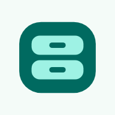
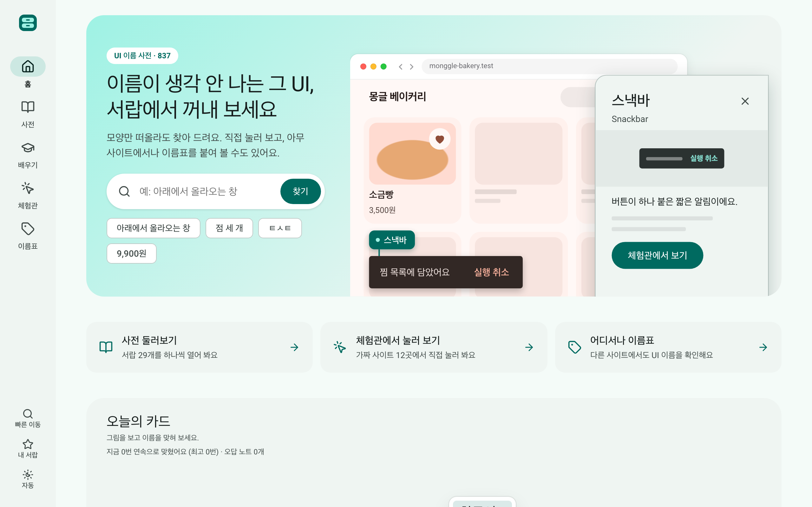
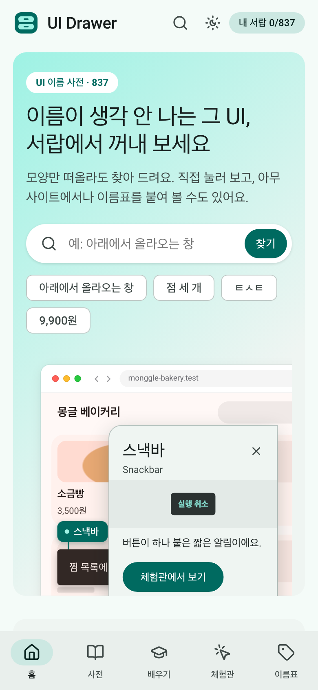
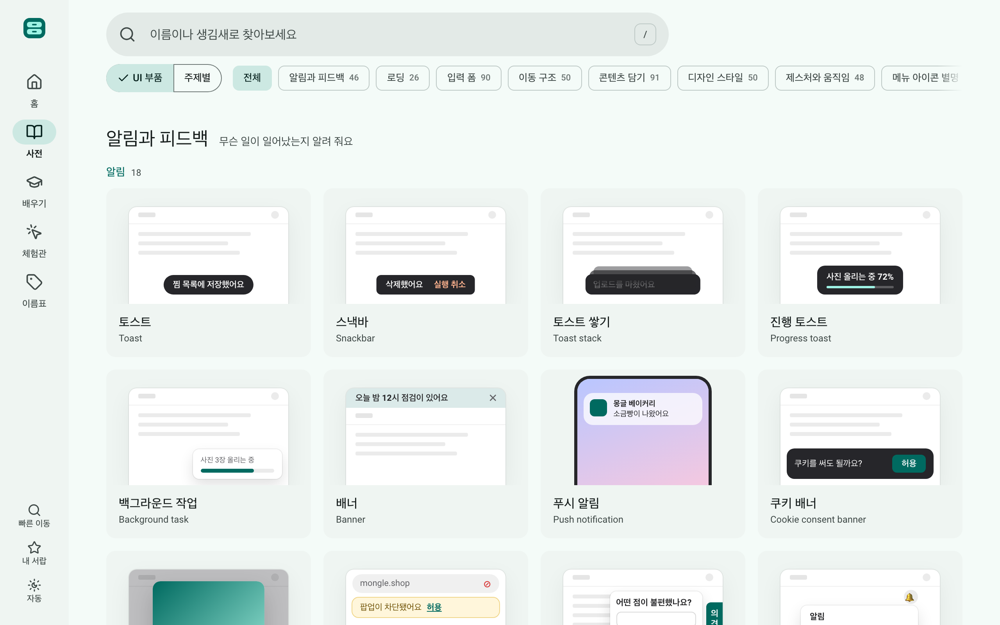
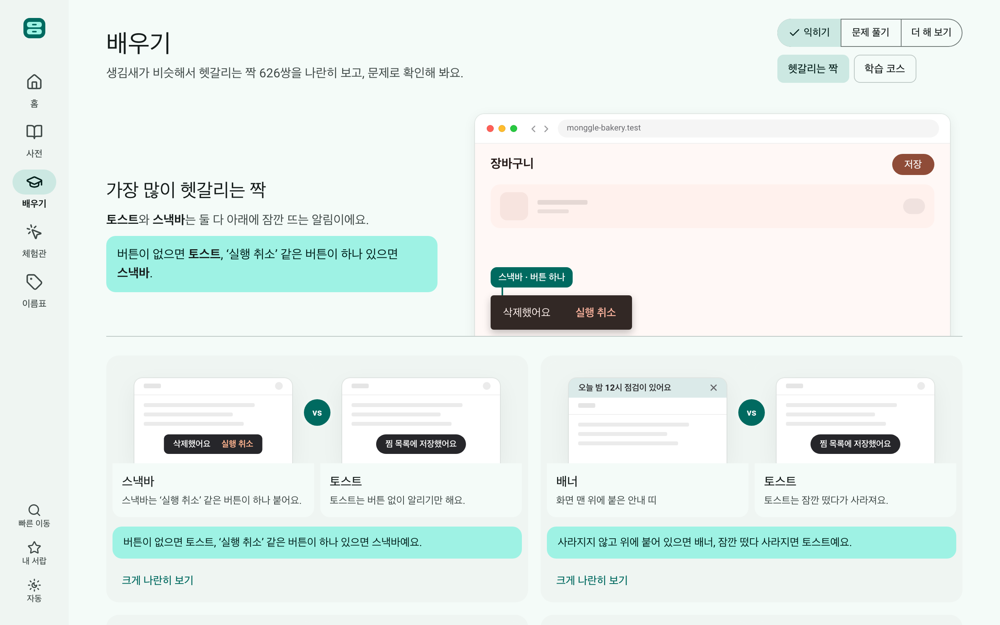
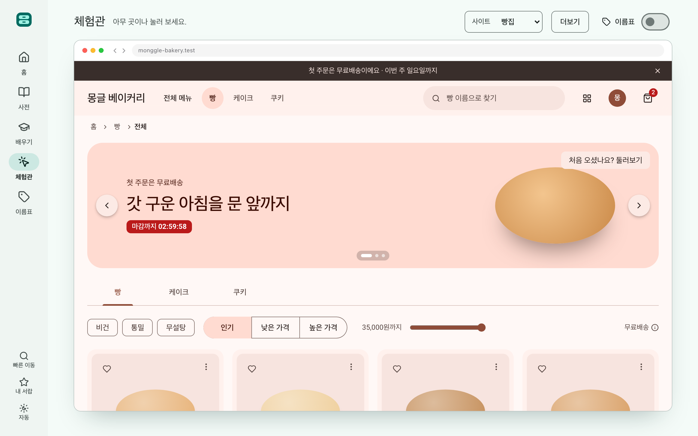
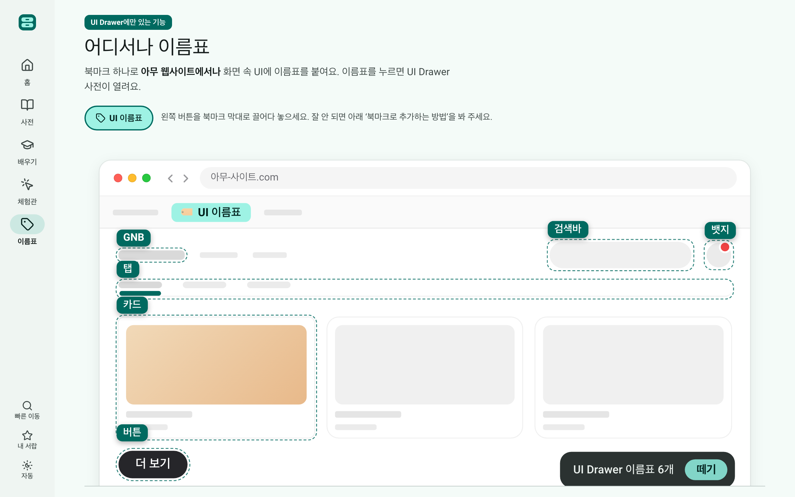

<div align="center">



# UI Drawer

**이름이 생각 안 나는 그 UI, 서랍에서 꺼내 보세요.**

토스트였나, 스낵바였나? 아래에서 올라오는 그 창은 뭐라고 부르지?<br>
생김새만 적으면 이름을 찾아 주고, 직접 눌러 보며 익히는 **UI 이름 사전**이에요.

<br>


<br>

 

</div>

<br>

## 이럴 때 써요

- 기획서에 **“그 아래에서 쓱 올라오는 거”**라고 적다가 멈췄을 때
- 디자이너와 개발자가 **같은 걸 다른 이름**으로 부르고 있을 때
- 토스트와 스낵바, 모달과 바텀시트처럼 **비슷한 둘이 헷갈릴 때**
- 처음 UI를 배우면서 **이름과 쓰임새를 한 번에** 익히고 싶을 때
- 바이브 코딩할 때 AI에게 **원하는 UI를 정확한 이름으로** 말하고 싶을 때

<br>

## 네 가지로 써요

<table>
<tr>
<td width="50%" valign="top">

### 🔍 사전
이름을 몰라도 돼요. **‘아래에서 올라오는 창’, ‘점 세 개’**처럼 보이는 대로 적거나 `ㅌㅅㅌ`처럼 초성만 적어도 찾아요. 카드마다 움직이는 그림, 언제 쓰는지, 무엇과 헷갈리는지가 있어요.



</td>
<td width="50%" valign="top">

### 🎓 배우기
헷갈리는 짝 600쌍 넘게 나란히 보고, 퀴즈로 확인해요. **‘버튼이 있으면 스낵바’**처럼 짝마다 한 줄로 가르는 법을 알려 주고, 틀린 것만 다시 풀 수도 있어요.



</td>
</tr>
<tr>
<td width="50%" valign="top">

### 🥐 체험관
빵집, 은행, 쇼핑몰, 메신저, 문서 편집기 같은 **가짜 사이트 12곳**에서 UI를 직접 눌러 봐요. **이름표**를 켜면 화면 속 UI마다 이름이 붙고, 스타일을 바꾸면 같은 사이트가 글래스 · 뉴모피즘 · 다크로 바뀌어요.



</td>
<td width="50%" valign="top">

### 🏷 어디서나 이름표
북마크 하나로 **아무 웹사이트에서나** 화면 속 UI에 이름표를 붙여요. 이름표를 누르면 사전 카드가 열려요. 크롬 · 엣지 · 파이어폭스 확장 프로그램도 있어요.



</td>
</tr>
</table>

<br>

## 숫자로 보면

| UI 카드 | 서랍 | 헷갈리는 짝 | 체험 사이트 | 직접 눌러 보는 UI |
|:---:|:---:|:---:|:---:|:---:|
| **1,454장** | **46개** | **600쌍+** | **12곳** | **176개** |

<details>
<summary><b>기능 전체 보기</b></summary>

<br>

| | |
|---|---|
| **카드** | 움직이는 그림 · 언제 쓰는지 · 헷갈리는 짝 · 잘 만드는 법 · 흔한 실수 · 접근성 점검 · 피그마 · iOS · HTML에서 부르는 이름 · 변천사 · 소리로 듣기 |
| **바이브 코딩** | 카드마다 ‘AI에게 만들어 달라고 하기’ 프롬프트 복사(React · HTML · Vue · SwiftUI · Flutter), 폴더 · 비교에 담은 카드로 화면 통째로 만들기 |
| **가져가기** | HTML · React · Vue · CSS · Tailwind 코드 복사, 피그마용 SVG, PNG 내려받기 |
| **일에 쓰기** | 나란히 보기 링크(`#/vs/카드/카드`), 화면 사진에 이름표 붙이기, 우리 팀이 부르는 이름, 화면 설명 글 · 팀 용어 투표 글, 디자인 시스템 점검표 |
| **배우기** | 학습 코스(입문 → 중급) · 퀴즈 · 스피드 대결 링크 · 틀린 것만 다시 · 자주 틀리는 이름 · 잘못 만든 UI 고치기 · 틀린 그림 찾기 |
| **체험관** | 사이트 12곳 + 휴대폰 앱, 스타일 8가지, 오류 상황(인터넷 끊김 · 서버 오류 · 빈 목록), 잘못 만든 버전, 미션 모드 |
| **내 서랍** | 열어 본 카드 · 폴더 · 오답 노트 · 업적 · 들른 날 · 공유 링크 · 용어집 내려받기. 모두 내 브라우저에만 저장돼서 가입이 필요 없어요. |
| **그 밖에** | 빠른 이동(⌘K) · 다크 모드 · 한국어/English · 큰 글자 · 고대비 · 오프라인 · 카드 링크 미리보기 · RSS |

</details>

<br>

## 시작하기

**Docker로 바로 띄우기**

```bash
docker compose up -d --build
# → http://localhost:8081   (포트 바꾸기: PORT=9000 docker compose up -d --build)
```

[Releases](../../releases)에서 zip을 받아 풀고 같은 명령을 써도 돼요.

**고쳐 보기**

```bash
cd app
npm install
npm run dev        # http://localhost:5180
npm test           # 테스트
npm run audit      # 사이트 전체 점검 (개발 서버를 켠 채로)
```

- 카드 더하기: `app/src/data.ts`에 항목 하나, `app/src/Preview.tsx`에 그림 하나
- 체험관에 이름표 붙이기: 사이트 요소에 `data-ui="카드 id"`를 달면 돼요

<sub>React 18 · TypeScript · Vite · Material 3 · 그림은 [Stageshow](NOTICE.md) 킷으로 그렸어요.</sub>

<br>

## 함께 만들기

- 사전에 없는 UI가 있나요? → [새 카드 제안하기](../../issues/new?template=new-card.yml)
- 그림이 이상하거나 잘 안 되는 곳이 있나요? → [고장 알리기](../../issues/new?template=bug.yml)
- 이런 다크 패턴을 봤어요 → [다크 패턴 알리기](../../issues/new?template=dark-pattern.yml)

<br>

## 만든 사람

**이명균** · [@aodrha03](https://github.com/aodrha03)<br>
소스 코드 · **hatility (하틸리티)** · [github.com/hatility/UI_Drawer](https://github.com/hatility/UI_Drawer)

## 라이선스

[MIT](LICENSE) © 2026 이명균 · hatility<br>
함께 쓴 오픈 소스는 [NOTICE.md](NOTICE.md)에 있어요. 체험관의 ‘몽글 베이커리’를 비롯한 가게들은 모두 지어낸 이름이에요.
